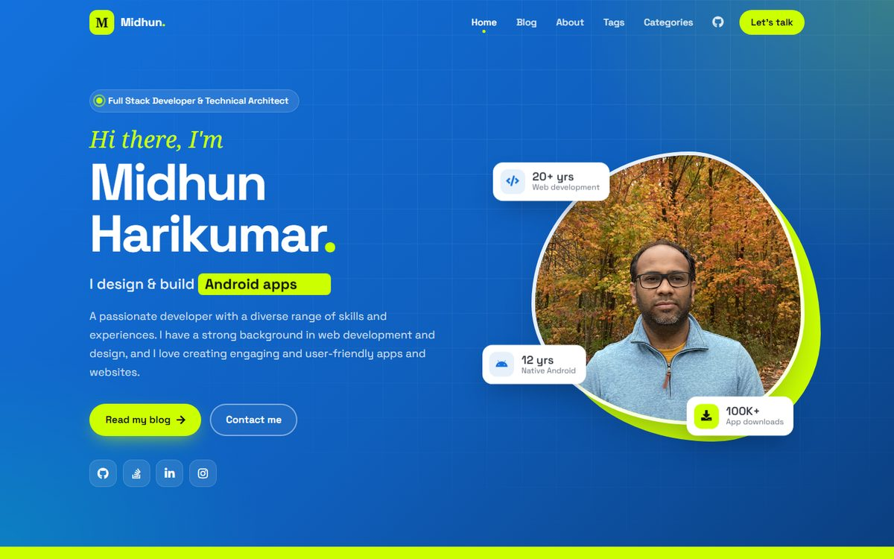
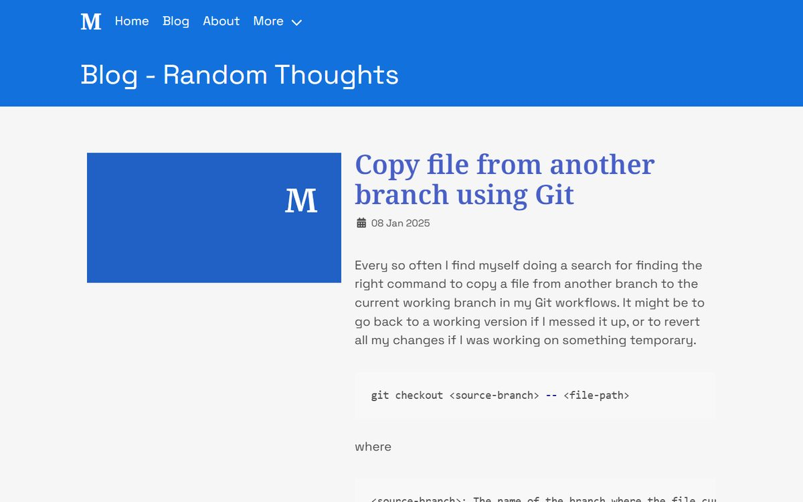
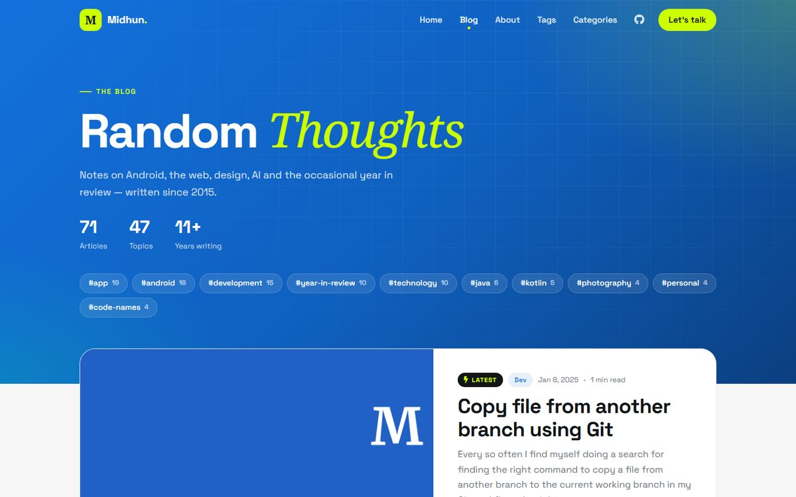

It has been almost two years since the last post here, and the theme of this site has been looking dated for even longer than that. Every time I thought about writing something new, I would look at the site and think "I should fix the design first". And then I would do neither.

So this time I did the redesign first, and the redesign is the post.
<!-- more -->

## What changed

The goal was to make the home page and the blog page look modern and a bit more catchy, while keeping the identity of the site. The blue `#1371DD` and the lime `#ccff00`, the Space Grotesk and Noto Serif fonts and the images all stay. Everything else around them got rebuilt.

### Home page

The old hero was a blue and lime split with the photo in the middle. The new one is a blue gradient with a subtle grid, a slowly morphing lime frame around the photo and a few floating stat cards. There is also a line that cycles through the things I build, and a lime band that scrolls through the tech stack.


*Before*


*After*

Further down, the "What I do" section, the featured projects and the latest posts are now cards that lift on hover, and the contact form got a proper split layout.

### Blog page

The blog used to be a plain list of posts with the full content of the shorter ones. Now it has a header with the post and topic counts and the most used tags, the latest post shown as a large card and the rest in a grid with an image, date, reading time and a short excerpt.


*Before*


*After*

The post pages also got a refresh: the date, reading time and category now appear in the header, the sidebar stays in view while scrolling and there are links to the previous and next posts at the end.

## Upgrading to Bulma 1

The site was still on Bulma 0.9, so this was a good time to move to [Bulma 1](https://bulma.io/). Bulma 1 is written with the Sass module system, which means the old `@import` based setup had to change to `@use`, and the customisation is now passed in with a `with` block.

```scss
@use "bulma/sass/utilities" with (
  $primary: #1371DD,
  $success: #ccff00,
  $family-sans-serif: ('Space Grotesk', sans-serif)
);
```

### Keeping the light theme

Bulma 1 comes with a dark theme that switches on automatically when the visitor's system prefers dark mode. That is a nice feature, but this site is designed to be light, and a lot of the older posts have colours that would not work on a dark background.

The default Bulma entry point forwards a `themes` module which outputs both the light and the dark theme. Instead of using it, I only register the light theme on `:root`, so the dark theme never ends up in the CSS at all.

```scss
@use "bulma/sass/utilities/initial-variables" as iv;
@use "bulma/sass/themes/light";
@use "bulma/sass/themes/setup";

#{iv.$variables-host} {
  @include light.light-theme;
  @include setup.setup-theme;
}
```

Along with `<html data-theme="light">` and a `color-scheme` meta tag, the site now stays light no matter what the system setting is.

### Only what is needed

The full Bulma 1 build came out at around 568 KB, which is a lot more than the 262 KB of the old build. Since this site only uses a handful of Bulma's components, I included only those modules (columns, buttons, tags, content, message and a few helpers). That brought the CSS down to 199 KB, which is smaller than what it was before the upgrade.

## Lessons learned

### A transition that overrode another

The cards on the home page fade in as you scroll, and they lift with a shadow on hover. After the redesign, the hover effect snapped back abruptly instead of easing out.

The reason was that the scroll reveal effect set its own `transition` for opacity and transform, and since that selector was more specific, it replaced the transition of the cards. The shadow and border changes were no longer being animated at all.

The fix was to use a CSS animation for the reveal instead of a transition, so that it never touches the `transition` property of the element.

```css
.js .reveal:not(.is-visible) { opacity: 0; }
.js .reveal.is-visible {
    animation: mh-reveal .8s ease var(--d, 0s) backwards;
}
@keyframes mh-reveal {
    from { opacity: 0; transform: translateY(28px); }
    to { opacity: 1; transform: none; }
}
```

The `backwards` fill mode is important here. It holds the starting frame during the delay, but lets go of the element once the animation is done, so the hover transform keeps working.

### Browsers hold on to old CSS

After deploying the new stylesheet, the browser kept serving the old cached version. Adding the site version to the stylesheet URLs makes sure that returning visitors get the new styles after every release.


```html
<link rel="stylesheet" href="/assets/css/app.css?v={{ site.version }}">
```


## Working with an AI coding agent

[TODO: Your own take here. For example how much of the redesign was done with an AI coding agent, what it did well, what you still had to catch yourself (like the hover issue) and whether you would work this way again. This could connect back to the post on [Beyond Automation](https://www.midhunhk.com/learning/2024/07/04/beyond-automation/).]

## What's next

[TODO: What you plan to write about next. For example the much delayed part 2 of [UX in Movies](https://www.midhunhk.com/learning/2024/01/01/ux-in-movies-part-1/), and a year in review for 2025 and 2026 come December.]

Hopefully the next post will not take two years. If you notice anything broken with the new design, do [drop me a note](https://www.midhunhk.com/#contact).
